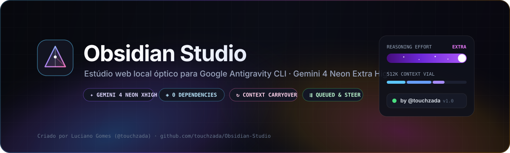

<div align="center">
  

  <br />
  <br />

  [](https://touchzada.github.io/Obsidian-Studio/)
  [](https://nodejs.org/)
  [](#arquitetura)
  [](https://github.com/touchzada)

  <p>
    <strong>Estúdio web local de estética óptica Smoked Obsidian</strong> para criar, editar e conversar em tempo real com agentes nativos do <strong>Google Antigravity CLI (<code>agy</code>)</strong> — com foco em <strong>Gemini 4 Neon (Extra High)</strong>, controle total de System Prompt, fila de mensagens enquanto o agente trabalha e troca de contas preservando o contexto.
  </p>
</div>

---

## ✨ Funcionalidades principais

- **🧠 Editor completo de System Prompt & Agentes Nativos**
  - Edição ao vivo de agentes nativos (`~/.gemini/config/agents/<slug>/agent.md`) e também de agentes em arquivo `.md` solto (ex.: agentes GSD), com seleção de ferramentas, pasta de trabalho (`cwd`), templates prontos e histórico de snapshots para restaurar versões anteriores.
- **⚡ Streaming em tempo real via `agy` (`stream-json`)**
  - Respostas com **5-step velvet ink-wash streaming** (`CSS.highlights`), renderização Markdown com tabelas e blocos de código dobráveis, visualização detalhada de chamadas de ferramentas (*tool cards*), temporizador de raciocínio, métricas reais de **TTFT**, **TPS (`tok/s`)** e **Cache Hit**.
- **⇶ Mensagens na fila + Enviar direto (*Queued Messages & Steer*)**
  - Continue digitando enquanto o agente trabalha:
    - **`Enter`** (ou `＋ Fila`): adiciona a mensagem na fila acima do composer e envia automaticamente assim que o turno atual termina.
    - **`Ctrl+Enter`** (ou `→`): interrompe o turno atual e envia imediatamente.
    - Cada item na fila permite **enviar agora (`→`)**, **editar (`✎`)** ou **remover (`🗑`)**, mantendo anexos.
- **◉ Troca de contas & Preservação automática de contexto**
  - Modal dedicado **Contas Antigravity** (acessível pelo topo e pela barra lateral) suportando os métodos oficiais do `agy`:
    - **Login Google OAuth** (fluxo oficial `/logout` + login no navegador).
    - **Perfis de Gemini API Key** (`--settings {"modelProvider":"gemini"}` + `GEMINI_API_KEY` + `GOOGLE_GEMINI_BASE_URL` opcional).
    - **Perfis Google Cloud ADC** (`AGY_ADC_AUTH=true` + `GOOGLE_CLOUD_QUOTA_PROJECT` / `LOCATION`).
  - **Context Carryover automático:** ao trocar de conta ou após um erro de cota (`Individual quota reached` / `429`), o Studio reinicia a sessão na conta ativa levando automaticamente o histórico completo da conversa daquela janela — sem perder o fio da meada.
- **🎨 Estética óptica Obsidian Prism**
  - 4 paletas (`Obsidian`, `Warm`, `Crystal`, `Alabaster`), 5 acentos ópticos (`Follow`, `Cobalt`, `Iris`, `Amber`, `Mono`), popovers em vidro fumê (zero `<select>` nativo), barra de nível de raciocínio (`Low` / `Medium` / `High` / `Extra`) + barra **Cut-Crystal** para Orchestrator, tubo físico de contexto **512K** e suporte nativo aos **4 pixel pets** (Whale, Dragon, Clawd, Cat — `4 pets`, `2 pets` ou `Nenhum`) que sobem sobre o card de mensagens na fila.
- **📎 Anexos, Slash Commands e Conversas Salvas**
  - Arraste/cole imagens e arquivos direto no composer, use comandos `/prompt`, `/models`, `/vial`, `/effort`, `/clear`, `/export` e gerencie conversas persistentes localmente (com exportação em `.md`).

---

## 🚀 Como rodar localmente

### Pré-requisitos
- **Node.js 20+** (zero `npm install` — não usa nenhuma dependência externa!)
- **Google Antigravity CLI (`agy`)** instalado e autenticado

### Passo a passo

```bash
# 1. Clone o repositório
git clone https://github.com/touchzada/Obsidian-Studio.git
cd Obsidian-Studio

# 2. Inicie o servidor local (http://127.0.0.1:4321)
npm start
```

No **Windows**, você também pode dar duplo clique em:
- `start-studio.bat` — abre o Obsidian Studio direto no navegador em `http://127.0.0.1:4321`
- `open-neon-cli.bat` — abre o `neon-agent` direto no terminal com `gemini-4-neon-xhigh`

### Integração opcional com o plugin Obsidian Prism
Se você tiver o plugin [Obsidian Prism](https://github.com/RMvdesi/obsidian-prism) instalado em `~/.gemini/config/plugins/obsidian-prism`, o `server.js` detecta e serve automaticamente os módulos reais de WebGL2 (ripple, aura de conversa, borda prismática 300Hz, smooth caret, slider de esforço, barra cut-crystal, 512K water vial e pets) via `/prism-vendor/*`. Sem o plugin, o Studio continua funcionando normalmente com fallback limpo.

---

## 🧱 Arquitetura

| Arquivo | Função |
| :--- | :--- |
| `server.js` | Servidor HTTP + SSE zero-dependências (Node nativo), CRUD de agentes em `~/.gemini/config/agents/`, sessões persistentes `agy`, upload de anexos, telemetria e perfis de autenticação |
| `public/index.html` | Estrutura do Studio/Chat, popovers ópticos, card de mensagens na fila, modal de contas e aparência |
| `public/app.js` | Runtime do cliente, streaming SSE incremental, fila/steer de mensagens, context carryover, renderizador Markdown e estado local |
| `public/prism-bridge.js` | Ponte óptica para os motores WebGL2/Canvas (aura, ripple, rim 300Hz, smooth caret, 512K vial, cut-crystal e mascots) |
| `public/styles.css` | Sistema visual Smoked Obsidian + 4 paletas + animações com mola amortecida |
| `docs/index.html` | Página showcase estática para GitHub Pages |

---

## ⌨️ Atalhos úteis

| Atalho | Ação |
| :--- | :--- |
| `Enter` | Enviar mensagem (ou **enfileirar** se o agente estiver trabalhando) |
| `Ctrl + Enter` | **Interromper e enviar agora** enquanto o agente trabalha |
| `Shift + Enter` | Quebra de linha no composer |
| `Ctrl + S` | Salvar o System Prompt atual no `agent.md` |
| `Ctrl + K` | Iniciar nova conversa limpa |
| `/` | Abrir menu de Slash Commands |
| `Esc` | Fechar popovers e modais |

---

## 🔒 Privacidade & Dados locais

Todos os seus dados locais (`data/` — conversas salvas, histórico de prompts, anexos, telemetria e perfis de autenticação) estão no `.gitignore` e **nunca** saem da sua máquina. O servidor escuta estritamente em `127.0.0.1:4321`.

---

## 👤 Créditos

<div align="center">
  <p>
    Idealizado e desenvolvido por <strong>Luciano Gomes</strong> (<a href="https://github.com/touchzada"><strong>@touchzada</strong></a>)
  </p>
  <p>
    Linguagem visual e módulos ópticos inspirados no <a href="https://github.com/RMvdesi/obsidian-prism">Obsidian Prism</a> · Powered by <a href="https://antigravity.google/">Google Antigravity CLI</a>
  </p>
</div>
